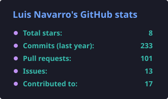
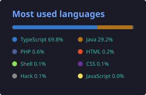

<h1 align="center">Luis Navarro</h1>

  <strong>Full-Stack Software Engineer</strong> 
  TypeScript · Next.js · Node.js · Python · Java · Quarkus · Spring · PostgreSQL

  
  

---

## About me

Full-stack software engineer. I design and build web applications end-to-end: from data modeling and APIs to the user experience in the browser. I work daily with **TypeScript, React, Next.js and Node.js** on the frontend/backend, **Python** for automation and AI integrations, and **Java + Spring + Quarkus** for enterprise and cloud-native systems. I deploy on **Docker, Railway, AWS and DigitalOcean**, mostly over **PostgreSQL**.

I focus on maintainable code, real-world performance (not marketing benchmarks) and products people actually use.

- 🧠 Learning & applying: LLM architectures (Claude, OpenAI), RAG, fine-tuning, autonomous agents
- 🌎 Open to remote opportunities
- 📫 Reach me on [LinkedIn](https://www.linkedin.com/in/luis-navarro-alvarez)

## Sobre mí

Ingeniero de software full-stack. Diseño y construyo aplicaciones web end-to-end: desde el modelado de datos y APIs hasta la experiencia de usuario en el navegador. Trabajo a diario con **TypeScript, React, Next.js y Node.js** en frontend/backend, **Python** para automatización e integraciones de IA, y **Java + Spring + Quarkus** en sistemas empresariales y cloud-native. Despliego en **Docker, Railway, AWS y DigitalOcean**, sobre **PostgreSQL** principalmente.

Me enfoco en código mantenible, performance real (no benchmarks de marketing) y producto que la gente realmente use.

- 🧠 Aprendiendo y aplicando: arquitecturas con LLMs (Claude, OpenAI), RAG, fine-tuning, agentes autónomos
- 🌎 Abierto a oportunidades remotas
- 📫 Contacto: [LinkedIn](https://www.linkedin.com/in/luis-navarro-alvarez)

---

## 🛠 Tech stack · Stack tecnológico

### Languages · Lenguajes

  

### Frontend

  

### Backend

  

  

### Databases · Bases de datos

  

### Cloud, DevOps & tools · Cloud, DevOps y herramientas

  

### AI & automation · IA y automatización

  
  
  
  

---

## 📊 GitHub

  
  

---

## 🌐 Connect · Redes

  
  
  
  

<!--
SEO keywords (hidden, helps GitHub/Google indexing in EN + ES):
Full-Stack Software Engineer, Full-Stack Developer, Software Engineer,
Next.js developer, TypeScript engineer, React developer, Node.js engineer,
Python developer, Spring Boot developer, Quarkus developer, Java backend developer,
Quarkus, cloud-native Java, PostgreSQL, remote software engineer, web applications developer,
desarrollador full-stack, ingeniero de software, desarrollador remoto,
desarrollador Next.js, desarrollador TypeScript, desarrollador Python.
-->
